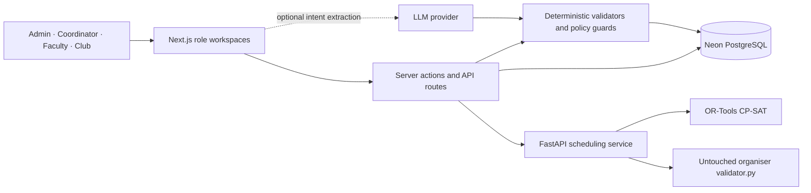

# TESSRA CIT

A full campus scheduling and operations ERP for **Chilika Institute of Technology (CIT)**. This repository retains the complete TESSRA role-based product while using the supplied CIT CrunchWeek starter pack as its only seeded academic/resource dataset.

- **Live application:** [https://tessra-cit.vercel.app](https://tessra-cit.vercel.app)
- **Public repository:** [https://github.com/linkkunall-sys/TESSRA-CIT](https://github.com/linkkunall-sys/TESSRA-CIT)

## Architecture



The LLM boundary is intentionally non-authoritative: model output can populate an intent, but deterministic code validates every timetable, room, booking, permission and approval decision before any write.

## Tech stack

| Layer | Technology |
|---|---|
| Web application | Next.js 16 App Router, React 19, TypeScript |
| Interface | Tailwind CSS, Lucide icons, self-hosted Inter Variable |
| Data | PostgreSQL on Neon, Drizzle ORM, node-postgres |
| Scheduling | Python, FastAPI, Google OR-Tools CP-SAT |
| Verification | Organiser `validator.py`, Node test runner, pytest, ESLint, TypeScript |
| Deployment | Vercel multi-service project with a private web-to-engine binding |
| Optional AI | OpenAI-compatible or Anthropic intent extraction with deterministic fallback |

## What is different in the CIT edition

The CIT data is not confined to a read-only benchmark page. It is imported into the normal relational model and powers every role workspace:

- **27 venues** with source room types, features, accessibility, allowed uses, and two period-level unavailability constraints
- **40 faculty profiles** with official source IDs, departments, daily limits, accessibility needs, hard unavailability, and soft preferences
- **14 student groups** and **62 courses** with the supplied year/contact-hour structure
- **189 directly editable teaching sessions** in the published timetable
- **25 booking requests**, including the official approvals, alternatives, rejections, series, raw wording, request windows, mandatory groups, and cancellation
- **41 examinations**, including multi-course and multi-room exams with official half-capacity seating
- The committed validator-clean CP-SAT schedule remains available in the official workbench for reproducibility and disruption repair

The source archive is preserved at `source/CrunchWeek_StarterPack-1.zip`. The extracted canonical dataset is under `official/starterpack/`, and app-produced exports are under `exports/`.

## Product capabilities

### Administrator

- Operational dashboard and audit trail
- Academic catalogue, groups, faculty constraints, teaching assignments, expected attendance, and elective baskets
- Versioned timetable generation, validation, manual edits, pinning, publication, CSV exports, and disruption repair
- Venue/resource catalogue, live availability checks, maintenance state, accessibility, and booking review
- Multi-room examination planning and clash/capacity validation
- Official CIT CP-SAT solve/validate/export workflow
- Account/access management, settings, coursework oversight, and atomic CIT baseline restore

### Department coordinator

- Department dashboard, timetable, faculty workload, approval queue, bookings, and reports

### Faculty

- Personal timetable, availability, change/extra-class requests, coursework, resources, and scheduling assistant

### Club representative

- Venue discovery, natural-language booking assistance, editable booking forms, and request tracking

## CIT-aware scheduling rules

- Monday–Friday, nine one-hour teaching periods, 08:00–18:00
- Lunch is 13:00–14:00 between P5 and P6
- Three-hour labs use P2–P4 or P6–P8
- Event-only periods P10–P13 remain available to booking workflows
- Faculty and room hard-unavailability constraints are enforced
- Official room-type, capacity, and accessibility eligibility is retained on each teaching assignment
- Open-elective basket sessions with the same `basket_slot` may overlap a group and regenerate synchronously; ordinary overlaps remain hard conflicts
- Exams may use several rooms; validation checks shared-room clashes and sums half of each room's capacity

## Demo sign-in

All demo accounts use password **`tessra123`**.

| Role | Email | Source identity |
|---|---|---|
| Administrator | `spectra.core.team@cit.ac.in` | Spectra Core Team |
| Department coordinator | `ece.department@cit.ac.in` | ECE Department |
| Faculty | `f01@cit.ac.in` | Dr. Ananya Mishra (F01) |
| Club representative | `coding.club@cit.ac.in` | Coding Club |

Email addresses are deterministic authentication adapters because the starter pack provides names/IDs but no login addresses. They do not introduce academic records outside the supplied data.

## Local setup

Requirements: Node.js 22+, npm, and PostgreSQL. Python 3 plus OR-Tools is needed only for local official CP-SAT generation; a deployed app can use `ENGINE_URL`.

```bash
npm ci
cp .env.example .env.local
```

Create an empty PostgreSQL database and apply either:

```bash
psql "$DATABASE_URL" -f supabase_schema_migration.sql
```

or the committed Drizzle migrations in order. The app can also bootstrap a completely empty database from the same migration chain on first request.

Then run:

```bash
npm run dev
```

The first request imports the CIT operational baseline. Do not point this repository at the original TESSRA database; this edition is designed for separate infrastructure.

## Environment variables

See `.env.example`. The principal values are:

- `DATABASE_URL` for PostgreSQL (the live deployment uses Neon)
- Optional `NEXT_PUBLIC_SUPABASE_URL`, `NEXT_PUBLIC_SUPABASE_ANON_KEY`, and `SUPABASE_SERVICE_ROLE_KEY` only when choosing Supabase Auth
- `ENGINE_URL` and optional `ENGINE_TOKEN` for the Python solver service
- Optional LLM keys used only for assistant intent extraction

Never commit `.env.local`, database credentials, service-role keys, or unrestricted deployment tokens.

## Verification

```bash
npm run typecheck
npm run lint
npm run test:unit
npm run build
python3 official/starterpack/CrunchWeek_StarterPack/validator.py \
  --data official/starterpack/CrunchWeek_StarterPack/data/cit_public.json \
  --schedule exports/schedule.json \
  --json /tmp/cit-report.json --quiet
```

The committed official baseline contains 189 placements and validates with **0 hard violations**. Operational tests additionally verify elective-basket overlap semantics and multi-room half-capacity examinations.

## Data fidelity and date adapters

The official format uses abstract weekdays for fest bookings and examinations, while the role product requires ISO dates. The import stores all source weekdays, windows, sessions, IDs, and raw request text, and also exposes deterministic operational dates:

- source label `Week 7 (Spectra '27)` → ISO week 7 beginning `2027-02-15`
- abstract exam week → the following week beginning `2027-02-22`

These adapters are explicit application metadata, not replacements for the canonical source values.

## Repository layout

- `src/app/` — Next.js role workspaces and API routes
- `src/db/schema.ts` — relational operational model
- `src/lib/seed.ts` — CIT import and atomic baseline restore
- `src/lib/scheduler.ts` — operational generator/validator
- `src/lib/official.ts` — official dataset, CP-SAT, and organiser-validator pipeline
- `engine/` — Python OR-Tools scheduling service
- `official/starterpack/` — untouched challenge pack
- `exports/` — validator-clean application exports
- `drizzle/` and `supabase_schema_migration.sql` — database schema chain

## Known limitations

- The supplied `cit-public-v1` dataset is the deliberately pinned operational baseline. Admins can upload organiser-format change files and restore the baseline, but the UI does not replace the entire base dataset with an arbitrary upload.
- Live official generation and minimum-move repair require the deployed Python engine service; committed validator-clean exports remain available for reproducibility.
- Runtime LLM configuration is optional. Without an API key, English/Hinglish booking intake and faculty assistance use deterministic parsers and the manual forms remain fully available.
- The current deployment uses Neon PostgreSQL and built-in database-backed demo authentication. Supabase credentials are not required or configured.
- Final submission still requires the team owner to provide the separate walkthrough-video URL requested by the problem statement.

## License and provenance

See `THIRD_PARTY.md` and `AI_USAGE.md`. The CIT starter pack remains preserved in-repository for challenge provenance and reset/reference behavior.
