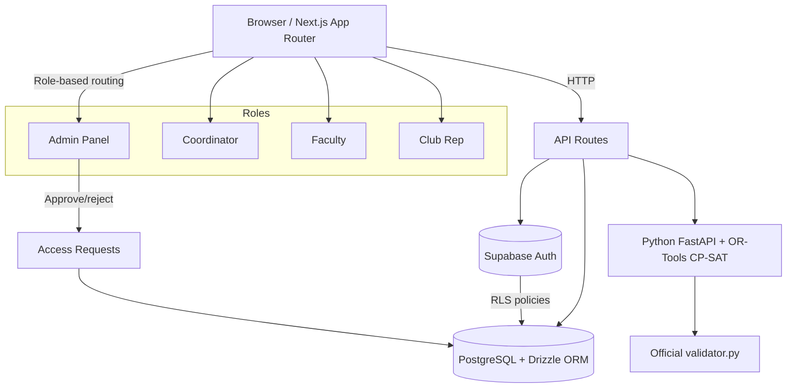
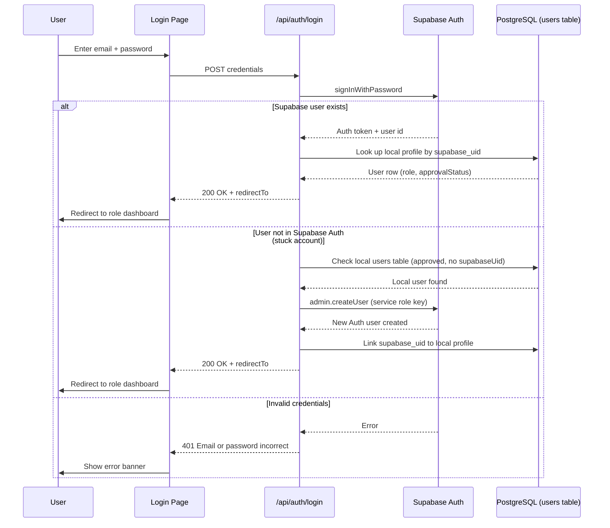

# TESSRA — Intelligent Campus ERP

**Smarter Schedules. Seamless Campus Operations.**

Built for the Crunch Week problem statement (Chilika Institute of Technology): timetable generation, Spectra-week venue bookings, midsem exams and disruption repair — with an OR-Tools CP-SAT engine graded by the organisers' own validator.

---

## 🔗 Live Links

| Service | URL |
|---------|-----|
| **Production (Vercel)** | https://tessra-five.vercel.app |
| **GitHub Repository** | https://github.com/kunalchwdry/TESSRA.git |

> ⚠️ **No public registration.** Use the demo accounts below (password for all: `tessra123`).

---

## 👥 Demo Accounts

All four demo accounts use password **`tessra123`** and are pre-approved.

| Role | Email | Dashboard |
|------|-------|-----------|
| **Admin** (Dean's office) | `admin@westbrook.edu` | `/admin` |
| **Department Coordinator** | `coordinator.cse@westbrook.edu` | `/coordinator` |
| **Faculty** | `ananya.rao@westbrook.edu` | `/faculty` |
| **Club Representative** | `robotics@westbrook.edu` | `/club` |

## ⚡ Three-minute evaluator path

1. Open the [live app](https://tessra-five.vercel.app), choose the **Administrator** demo card, and sign in (the shared password is prefilled by the card).
2. On **Admin Overview**, use the **Quick start** strip:
   - **Find a room** → enter capacity plus a date/time; results are checked live against classes, exams and approved bookings.
   - **Read the timetable** → open the published week and switch between group, faculty and room views.
   - **Approve a change** → open Approval Centre. If the clean demo queue is empty, click **Prepare approval example**; it creates one genuine conflict-free faculty request that can be approved or rejected normally.
3. Press **Ctrl/⌘ K** anywhere to search pages by intent — try “room”, “timetable”, “approval”, or “booking”.
4. For official scoring, open **Admin → Official Dataset**. Switch the full CIT timetable between group/faculty/room (phones receive a day agenda), generate/download `schedule.json`, upload a disruption JSON, inspect the exact diff, and separately approve it before `schedule_after.json` unlocks.
5. AI checks: as **Club**, open New Booking and try the English/Hinglish/conditional examples (or a priority-bypass prompt); every result is an editable, policy-capped draft. As **Faculty**, select a timetable class to ask “why this slot?” and inspect the hard-validity facts before trying a change request.
6. Optional: Coordinator → department approvals and faculty/resource views.

No evaluator-only bypass exists: availability, changes, approvals and exports use the same validation and audit paths as normal actions.

### Full access credentials

See **[access.md](./access.md)** for the complete list of accounts, passwords, Supabase project details, Vercel deployment info, and database migration data.

---

## 🏗 Architecture



---

## 🔐 Authentication Flow



---

## 📋 Access Request Flow

```mermaid
flowchart TD
    Start[User visits /access-request] --> Form[Fill form: name, email, password, role, dept/club, reason]
    Form --> POST[POST /api/access-requests]
    POST --> Store[Store in access_requests table (status: pending)]
    Store --> Email[Success banner shown]
    Admin[Admin visits /admin/access-requests] --> Table[View pending requests table]
    Table --> Approve[Click Approve]
    Approve --> Create[Create local user record]
    Create --> SupabaseAuth[Create Supabase Auth user via service role key]
    SupabaseAuth --> Link[Link supabase_uid to local profile]
    Link --> Update[Mark request as approved]
    Update --> Notify[User can now sign in with email + password]
```

---

## 🚀 Quick Start

Prerequisites: **Node.js 22+**, Python 3.10+ and PostgreSQL.

```bash
# 1. Clone the repository
git clone https://github.com/kunalchwdry/TESSRA.git
cd TESSRA

# 2. Install dependencies
npm ci
python3 -m pip install -r engine/requirements.txt pytest

# 3. Set up environment
cp .env.example .env
# Edit .env with your Supabase credentials (see access.md for production values)

# 4. Set up database
npx drizzle-kit push   # generates and applies schema (26 tables)
# or for local dev with PostgreSQL:
# DATABASE_URL=postgresql://localhost:5432/tessra npx drizzle-kit push

# 5. Run the dev server
npm run dev
# Open http://localhost:3000

# 6. Run tests
npm exec tsc -- --noEmit && npm run build && npx eslint .
python3 -m pytest engine/tests -q
```

### Supabase setup (production)

TESSRA supports two auth modes:

1. **Custom session auth (default)** — works out of the box with local PostgreSQL.
2. **Supabase Auth (recommended for production)** — set these in `.env`:

   ```env
   NEXT_PUBLIC_SUPABASE_URL=https://lsdytdpaqogcvutaordj.supabase.co
   NEXT_PUBLIC_SUPABASE_ANON_KEY=your-anon-key
   SUPABASE_SERVICE_ROLE_KEY=your-service-role-key
   DATABASE_URL=your-supabase-postgres-connection-string
   ```

   Then run the RLS migration:
   ```bash
   psql $DATABASE_URL < supabase/migrations/20261031000001_rls_policies.sql
   ```

---

## 📊 Official Results (validator.py, unmodified)

| Export | Hard violations | Soft | Bookings | Stability |
|--------|----------------|------|----------|-----------|
| `exports/schedule.json` | **0** | 3 | 65.5 / 70 · 0 inversions | — |
| `exports/schedule_after.json` | **0** | 3 | — | **8 sessions moved** (2 time, 6 room-only) |

Both files were produced by `engine/solve.py`, not edited by hand, and then checked with the unmodified organiser `validator.py`. Reports: `exports/report.json` and `exports/report_after.json`.

The production judge path has also been exercised after an Admin reset: **Generate schedule** placed 189/189 sessions and 41/41 exams, returned 0 hard violations, stored the run and served a downloadable export. Re-running the organiser validator locally on that live download produced the same report byte-for-byte at the JSON-data level.

---

## 📁 Repository Structure

```
engine/          — CP-SAT model (hard H1–H14, soft S1–S6), bookings, exams, repairs, CLI + FastAPI + pytest
official/        — Untouched starter pack + problem statement
exports/         — App-produced schedule.json, schedule_after.json, validator reports
src/             — Next.js App Router: four role workspaces, auth, audit, notifications
docs/            — requirements, architecture, deployment, testing and submission audit evidence
access.md        — Complete access credentials (this repo)
AI_USAGE.md      — Full AI declaration
IMPLEMENTATION_STATUS.md — What works, what's tested, what's pending
```

---

## 🎯 Key Features

- **Four roles** with Row Level Security (RLS): Admin, Coordinator, Faculty, Club Representative
- **Access requests** — non-admin roles must request access; admin approves/rejects
- **Instant account creation** — admin can create accounts directly at `/admin/create-account`
- **Supabase Auth** — email/password auth with email confirmation enabled
- **Notifications** — in-app notification system
- **Audit logs** — complete audit trail of all actions
- **Timetable/booking validation** — conflict-checked with suggested alternatives
- **English/Hinglish booking intake** — fills the real editable form, exposes assumptions, asks for missing essentials and revalidates on submit
- **Faculty AI schedule assistant** — optional LLM intent proposal, deterministic constraint validation, human submission and coordinator approval
- **CP-SAT engine** — exact H1–H14 model and S1–S6 objective, official booking/exam allocation, and a lexicographic repair that proves the minimum number of baseline moves before optimizing soft quality
- **Governed repair workflow** — upload any valid organiser change JSON, inspect the exact before/after diff, then approve or reject it; `schedule_after.json` stays locked until approval
- **Safe Admin reset** — one-click clean demo state with complete timetable regeneration; accounts/reference data and the active login are preserved
- **Demo accounts** — four pre-seeded accounts for evaluation

---

## Known limitations

- The four role workspaces use a compact seeded campus dataset for fast judging; the full official CIT dataset, bookings, exams, validator report and disruption repair are presented under `/admin/official`.
- The official workflow intentionally fixes the organiser-provided CIT dataset as the grading source. Admins can upload arbitrary organiser-format disruption JSON (all five supported change types); replacement base-dataset upload is not exposed.
- Production deploys the included FastAPI/OR-Tools engine as a private Vercel Python Service and injects `ENGINE_URL` through a service binding. Local development can use that URL or the Python subprocess fallback.
- External LLM intent parsing is optional and requires a team-supplied key. The deterministic assistant, English/Hinglish booking parser and manual booking form work without it.

---

## 📄 Documentation

- `docs/ARCHITECTURE.md` — System design and component overview
- `docs/DEPLOYMENT.md` — Vercel + Supabase deployment guide
- `docs/DATA_DICTIONARY.md` — All 26 tables and their fields
- `docs/REQUIREMENTS_TRACEABILITY.md` — Requirement → implementation mapping
- `docs/CONSTRAINT_VERIFICATION.md` — H1–H14/S1–S6 model and executed validator evidence
- `docs/TESTING.md` — Test strategy and coverage
- `docs/SUBMISSION_AUDIT.md` — Official-file, ZIP, constraint and defensible score audit
- `IMPLEMENTATION_STATUS.md` — Current implementation state

---

**Built with:** Next.js (App Router) · TypeScript · Tailwind CSS · PostgreSQL + Drizzle ORM · Supabase Auth · Python FastAPI · Google OR-Tools CP-SAT · Lucide Icons